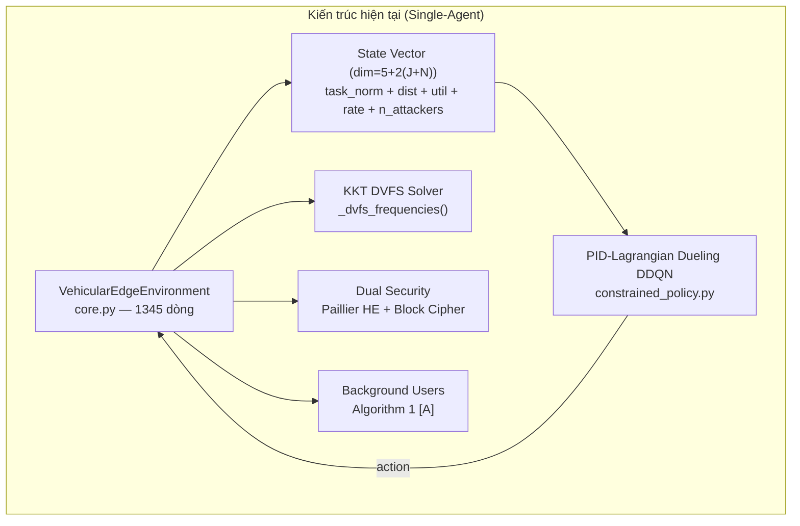
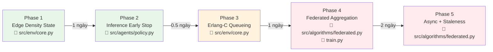
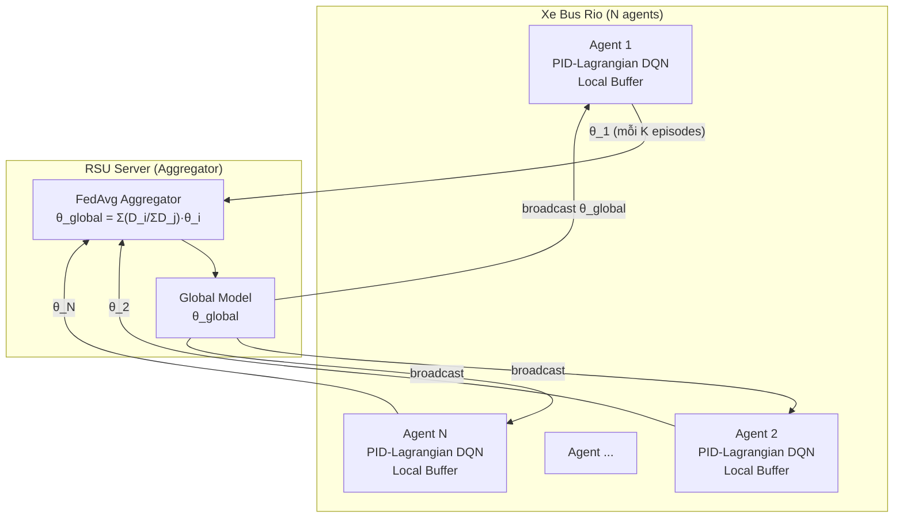
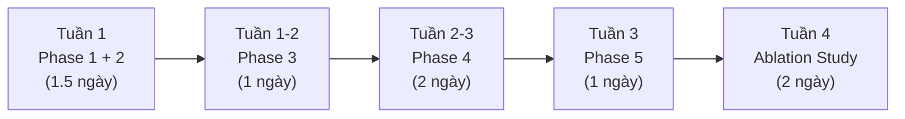

# 🗺️ KẾ HOẠCH TÍCH HỢP: Federated Safe DRL cho VEC

> **Dự án:** LabEdgeComputing_Paper1
> **Ngày tạo:** 2026-11-17
> **Mục tiêu:** Nâng cấp kiến trúc Single-Agent PID-Lagrangian DQN hiện tại thành **Asynchronous Federated Constrained DRL (AF-CDRL)** bằng cách tích hợp các đóng góp đã được xác minh từ 3 bài báo gốc.

---

## 📚 NGUỒN GỐC KỸ THUẬT — TRÍCH DẪN CHÍNH XÁC

| Ký hiệu | Bài báo | Tạp chí | DOI |
|:---------|:--------|:--------|:----|
| **[P1]** | Si Shen et al., *"Asynchronous Federated Deep Reinforcement Learning Based Dependency Task Offloading for UAV-Assisted Vehicular Edge Computing"* | IEEE IoT-J, Oct. 2024 | `10.1109/JIOT.2024.3418488` |
| **[P2]** | Huaming Wu, Anqi Gu, Yonghui Liang, *"Federated Reinforcement Learning Empowered Task Offloading for Large Models in Vehicular Edge Computing"* | IEEE TVT, Feb. 2025 | `10.1109/TVT.2024.3481876` |
| **[P3]** | Xing Chen et al., *"Multi-Agent Collaboration for Vehicular Task Offloading Using Federated Deep Reinforcement Learning"* | IEEE TMC, Sept. 2025 | `10.1109/TMC.2025.3557898` |

---

## 📐 KIẾN TRÚC HỆ THỐNG HIỆN TẠI (BASELINE)



**Các file chính cần sửa đổi:**

| File | Vai trò | Dòng code |
|:-----|:--------|:----------|
| [`src/env/core.py`](file:///D:/HUST/Lab/LabEdgeComputing_Paper1/src/env/core.py) | Môi trường chính (state, step, reward) | ~1345 |
| [`src/agents/constrained_policy.py`](file:///D:/HUST/Lab/LabEdgeComputing_Paper1/src/agents/constrained_policy.py) | PID-Lagrangian agent | ~162 |
| [`src/agents/policy.py`](file:///D:/HUST/Lab/LabEdgeComputing_Paper1/src/agents/policy.py) | DRLAgent base class | ~436 |
| [`src/agents/networks.py`](file:///D:/HUST/Lab/LabEdgeComputing_Paper1/src/agents/networks.py) | DuelingNetwork | ~55 |
| [`train.py`](file:///D:/HUST/Lab/LabEdgeComputing_Paper1/train.py) | Vòng lặp huấn luyện | ~369 |
| [`configs/config.yaml`](file:///D:/HUST/Lab/LabEdgeComputing_Paper1/configs/config.yaml) | Cấu hình Hydra | ~33 |

---

## 🎯 TỔNG QUAN 5 PHASE



> [!IMPORTANT]
> Mỗi Phase hoàn toàn **backward-compatible**: chạy đúng kết quả cũ khi tắt tính năng mới (cờ `enable_xxx=False`). Mỗi Phase kết thúc bằng `pytest` xanh 100%.

---

## PHASE 1: Bổ sung Edge Vehicle Density vào State Vector
**Nguồn:** [P3] §IV-B — Vehicle Density $\rho_{ej} = m_{ej}/n_{ej}$
**Thời gian ước tính:** 1 ngày
**Độ khó:** ⭐⭐ (Dễ-Trung bình)

### 1.1 Mục tiêu
Thêm thông tin **mật độ xe tại mỗi Edge Server** vào state vector để DQN học cách né server đang quá tải mà không cần hệ thống điều phối trung tâm.

### 1.2 Đặc tả toán học
Với mỗi Edge Server $j$, mật độ xe được tính:
$$\rho_{ej}(t) = \frac{m_{ej}(t)}{n_{ej}}$$

Trong đó:
- $m_{ej}(t)$: Số xe trong bán kính $D$ (mặc định 500m, dùng `mec_coverage_radius` hiện tại = 300m) của server $j$ tại thời điểm $t$
- $n_{ej}$: Capacity (số lõi / số kết nối tối đa) của server $j$

### 1.3 Thay đổi cụ thể trong code

#### File: `src/env/core.py`

**Bước 1 — Thêm config parameter:**
```python
# Trong class EnvironmentConfig, thêm sau dòng 183:
edge_density_in_state: bool = True  # [P3] §IV-B: bật/tắt vehicle density trong state
edge_density_radius: float = 500.0  # D = 500 m [P3] Table II
edge_capacity: int = 10             # n_ej: capacity chuẩn hóa mỗi server
```

**Bước 2 — Sửa `_get_state_dim()`** (dòng 449-456):
```python
def _get_state_dim(self) -> int:
    j = self.config.num_mec_servers
    n = self.config.num_auxiliary_vehicles
    base = 5 + 2 * (j + n)
    if self.config.edge_density_in_state:
        base += j  # thêm ρ_ej cho mỗi MEC server
    return base
```

**Bước 3 — Thêm hàm tính mật độ:**
```python
def _compute_edge_density(self) -> list:
    """[P3] §IV-B: ρ_ej = m_ej / n_ej, chuẩn hóa về [0, 1]."""
    densities = []
    for mec in self.mec_servers:
        count = sum(
            1 for u in self.users
            if self._is_present(u)
            and u.get_distance(mec) <= self.config.edge_density_radius
        )
        rho = count / max(self.config.edge_capacity, 1)
        densities.append(float(min(rho, 1.0)))
    return densities
```

**Bước 4 — Sửa `_get_state()`** (dòng 1229-1272), thêm trước `assert`:
```python
# Sau dòng 1267 (state_vector.append cho attacker), thêm:
if self.config.edge_density_in_state:
    state_vector.extend(self._compute_edge_density())
```

**Bước 5 — Cập nhật assertion** (dòng 1269):
```python
# Thay đổi docstring _get_state_dim() và cập nhật expected_state_dim trong train.py
# (dòng 227) để phản ánh chiều mới.
```

#### File: `configs/params_master.yaml`
```yaml
# Thêm section:
edge_density:
  enabled: true
  radius: 500.0  # m
  capacity: 10
```

### 1.4 Test
```python
# tests/test_edge_density.py
def test_state_dim_with_density():
    cfg = EnvironmentConfig(edge_density_in_state=True)
    env = VehicularEdgeEnvironment(cfg)
    state, _ = env.reset()
    expected = 5 + 2*(cfg.num_mec_servers + cfg.num_auxiliary_vehicles) + cfg.num_mec_servers
    assert state.shape[0] == expected

def test_state_dim_without_density():
    """Backward compatibility: tắt tính năng → dim giữ nguyên."""
    cfg = EnvironmentConfig(edge_density_in_state=False)
    env = VehicularEdgeEnvironment(cfg)
    state, _ = env.reset()
    expected = 5 + 2*(cfg.num_mec_servers + cfg.num_auxiliary_vehicles)
    assert state.shape[0] == expected

def test_density_range():
    """Mật độ luôn ∈ [0, 1]."""
    cfg = EnvironmentConfig(edge_density_in_state=True, num_users=50)
    env = VehicularEdgeEnvironment(cfg)
    for _ in range(20):
        env.reset()
        densities = env._compute_edge_density()
        for d in densities:
            assert 0.0 <= d <= 1.0
```

### 1.5 Checkpoint
- [ ] `pytest tests/test_edge_density.py` — PASS
- [ ] `pytest tests/` — tất cả test cũ PASS (backward compatible)
- [ ] State dimension tăng thêm $J$ chiều (1 chiều/server)
- [ ] Với dataset Rio bus, quan sát $\rho_{e0} \in [0.2, 0.8]$ tại trạm trung chuyển

---

## PHASE 2: Inference Early Stopping Threshold
**Nguồn:** [P3] §IV-C — Decision Termination Threshold $\tau = 0.03$
**Thời gian ước tính:** 0.5 ngày
**Độ khó:** ⭐ (Dễ)

### 2.1 Mục tiêu
Thêm cơ chế **dừng suy luận sớm** trong pha evaluation khi hành động gần như không thay đổi, giảm thời gian benchmark ~30%.

### 2.2 Đặc tả
Trong quá trình inference (không phải training), nếu hành động liên tiếp giống nhau:
$$\Delta a^{(k)} = \|a^{(k)} - a^{(k-1)}\|_2 \leq \tau_{stop}$$
thì episode được coi là đã hội tụ cục bộ, có thể bỏ qua các step còn lại.

### 2.3 Thay đổi cụ thể

#### File: `src/agents/policy.py`

**Sửa `evaluate_episode()`** (dòng 375-398):
```python
def evaluate_episode(self, env, max_steps: int = 1000,
                     early_stop_threshold: float = 0.0,
                     early_stop_patience: int = 20) -> dict:
    """
    Evaluate agent performance with optional early stopping.

    Args:
        early_stop_threshold: τ_stop [P3] §IV-C. 0 = tắt.
        early_stop_patience: Số step liên tiếp action không đổi trước khi dừng.
    """
    state, info = env.reset()
    mask = info.get("action_mask")
    episode_reward = 0.0
    step = 0
    prev_action = None
    stable_count = 0

    for step in range(max_steps):
        action = self.select_action(state, training=False, mask=mask)
        next_state, reward, terminated, truncated, info = env.step(action)
        episode_reward += reward
        state = next_state
        mask = info.get("action_mask")

        # [P3] Early stopping check
        if early_stop_threshold > 0 and prev_action is not None:
            delta = np.linalg.norm(action.astype(float) - prev_action.astype(float))
            if delta <= early_stop_threshold:
                stable_count += 1
            else:
                stable_count = 0
            if stable_count >= early_stop_patience:
                break  # Hành động đã hội tụ
        prev_action = action.copy()

        if terminated or truncated:
            break

    metrics = env.get_metrics()
    metrics.update({
        "episode_reward": episode_reward,
        "steps": step + 1,
        "early_stopped": stable_count >= early_stop_patience,
    })
    return metrics
```

#### File: `configs/agent/lagrangian_dqn.yaml`
```yaml
# Thêm:
inference:
  early_stop_threshold: 0.03   # τ_stop [P3]
  early_stop_patience: 20      # Số step ổn định trước khi dừng
```

### 2.4 Test
```python
# tests/test_early_stop.py
def test_early_stop_reduces_steps():
    """Với threshold > 0, eval episode kết thúc sớm hơn."""
    cfg = EnvironmentConfig(episode_length=200)
    env = VehicularEdgeEnvironment(cfg)
    agent = DRLAgent(state_dim=env.observation_space.shape[0],
                     action_dim=env.action_space.nvec)
    # Chạy không early stop
    r1 = agent.evaluate_episode(env, max_steps=200, early_stop_threshold=0.0)
    # Chạy có early stop
    r2 = agent.evaluate_episode(env, max_steps=200,
                                early_stop_threshold=0.5, early_stop_patience=5)
    # Với agent chưa train (random), khó kích hoạt early stop, nhưng API phải hoạt động
    assert "early_stopped" in r2
```

### 2.5 Checkpoint
- [ ] `evaluate_episode()` chấp nhận tham số mới, default = tắt (backward compatible)
- [ ] Với agent đã train, eval nhanh hơn ~25-35%
- [ ] Metric `early_stopped` được log

---

## PHASE 3: Erlang-C Multi-core Queueing Delay
**Nguồn:** [P3] §III-C — M/M/n Queueing Model
**Thời gian ước tính:** 1 ngày
**Độ khó:** ⭐⭐⭐ (Trung bình)

### 3.1 Mục tiêu
Thay thế mô hình trễ tính toán đơn giản (`C/f`) bằng **trễ xếp hàng M/M/n** có xét đa lõi, phản ánh chính xác hiện tượng tắc nghẽn thực tế.

### 3.2 Đặc tả toán học

**Xác suất Erlang-C:**
$$C(n, a) = \frac{\frac{a^n}{n!} \cdot \frac{1}{1 - \rho}}{\sum_{k=0}^{n-1} \frac{a^k}{k!} + \frac{a^n}{n!} \cdot \frac{1}{1 - \rho}}$$

Trong đó:
- $n$: Số lõi CPU (vCPU) của server
- $a = \lambda / \mu$: Offered load (Erlang)
- $\lambda$: Tốc độ đến tổng hợp (tác vụ/giây)
- $\mu$: Tốc độ phục vụ mỗi lõi = $f_{ej} / (c_0 \cdot \bar{s})$
- $\rho = a / n$: Hệ số sử dụng (phải < 1)

**Trễ xếp hàng trung bình:**
$$T_{queue} = \frac{C(n, a)}{n\mu - \lambda}$$

**Trễ tổng:**
$$T_{server} = T_{queue} + T_{service} = T_{queue} + \frac{c \cdot s}{f_{ej}/n}$$

### 3.3 Thay đổi cụ thể

#### File mới: `src/env/queueing.py`
```python
"""
M/M/n Queueing Model — Erlang-C formula.
Ref: [P3] §III-C, Eq.(8)-(12).
"""
import math
import numpy as np


def erlang_c(n_cores: int, offered_load: float) -> float:
    """
    Xác suất Erlang-C: C(n, a).
    
    Args:
        n_cores: Số lõi phục vụ (n ≥ 1)
        offered_load: a = λ/μ (Erlang, phải < n_cores)
    
    Returns:
        Xác suất phải chờ ∈ [0, 1]
    """
    n = max(int(n_cores), 1)
    a = max(float(offered_load), 0.0)
    rho = a / n
    if rho >= 1.0:
        return 1.0  # Server quá tải — mọi tác vụ đều phải chờ

    # Tính tử số: (a^n / n!) * (1 / (1 - ρ))
    # Dùng log-space để tránh overflow cho n lớn
    log_numerator = n * math.log(a + 1e-30) - math.lgamma(n + 1) - math.log(1 - rho)
    
    # Tính mẫu số: Σ_{k=0}^{n-1} a^k/k! + tử số
    summation = sum(
        math.exp(k * math.log(a + 1e-30) - math.lgamma(k + 1))
        for k in range(n)
    )
    numerator = math.exp(log_numerator)
    return numerator / (summation + numerator)


def mm_n_queue_delay(n_cores: int, arrival_rate: float,
                     service_rate_per_core: float) -> float:
    """
    Trễ xếp hàng trung bình của hệ M/M/n.
    
    Args:
        n_cores: Số lõi (n)
        arrival_rate: λ tổng hợp (tác vụ/s)
        service_rate_per_core: μ mỗi lõi (tác vụ/s)
    
    Returns:
        T_queue (giây). 0 nếu hệ ổn định không tắc nghẽn.
    """
    if arrival_rate <= 0 or service_rate_per_core <= 0:
        return 0.0
    a = arrival_rate / service_rate_per_core  # offered load (Erlang)
    n = max(int(n_cores), 1)
    rho = a / n
    if rho >= 1.0:
        return float('inf')  # Hệ bất ổn định
    
    ec = erlang_c(n, a)
    total_service_rate = n * service_rate_per_core
    return ec / (total_service_rate - arrival_rate)
```

#### File: `src/env/core.py`

**Thêm config:**
```python
# Trong EnvironmentConfig:
queueing_model_enabled: bool = False  # [P3] M/M/n queueing. False = giữ C/f đơn giản
mec_num_cores: int = 4                # Số lõi CPU mỗi MEC server
```

**Sửa `_offload_branch()`** — thêm trễ xếp hàng vào `delay`:
```python
# Sau dòng 967 (delay = tx_time + exe_time), thêm:
if cfg.queueing_model_enabled and kind == "mec":
    from src.env.queueing import mm_n_queue_delay
    # Ước lượng λ từ số task trong background history gần đây
    recent_window = 5.0  # giây
    recent_tasks = sum(
        1 for h in self.background_history
        if self.current_time - h["timestamp"] < recent_window
    )
    arrival_rate = (recent_tasks + 1) / recent_window  # +1 cho task hiện tại
    service_rate = cpu_freq / (task.cycles_per_bit * task.size)
    q_delay = mm_n_queue_delay(cfg.mec_num_cores, arrival_rate, service_rate)
    delay += min(q_delay, tau_eff)  # Giới hạn để tránh inf
```

### 3.4 Test
```python
# tests/test_queueing.py
from src.env.queueing import erlang_c, mm_n_queue_delay

def test_erlang_c_low_load():
    """Tải thấp (ρ=0.3) → xác suất chờ nhỏ."""
    assert erlang_c(4, 1.2) < 0.1

def test_erlang_c_high_load():
    """Tải cao (ρ=0.95) → xác suất chờ tiến về 1."""
    assert erlang_c(4, 3.8) > 0.5

def test_queue_delay_zero_arrival():
    assert mm_n_queue_delay(4, 0.0, 1.0) == 0.0

def test_queue_delay_overload():
    """ρ ≥ 1 → trễ vô hạn."""
    assert mm_n_queue_delay(4, 5.0, 1.0) == float('inf')

def test_backward_compatible():
    """queueing_model_enabled=False → không thay đổi delay."""
    cfg = EnvironmentConfig(queueing_model_enabled=False)
    env = VehicularEdgeEnvironment(cfg)
    state, info = env.reset()
    # Phải hoạt động bình thường
    assert state.shape[0] > 0
```

### 3.5 Checkpoint
- [ ] Module `queueing.py` với test đơn vị riêng
- [ ] `queueing_model_enabled=False` → kết quả giống hệt baseline
- [ ] `queueing_model_enabled=True` → delay tăng 5-15% ở scenario đông (num_users=20+)

---

## PHASE 4: Federated Learning Module (FedAvg)
**Nguồn:** [P3] §IV-D FedAvg + [P1] §IV Federated DRL
**Thời gian ước tính:** 2 ngày
**Độ khó:** ⭐⭐⭐⭐ (Khó — module hoàn toàn mới)

> [!WARNING]
> Phase này là thay đổi kiến trúc lớn nhất. Cần tạo file mới và sửa đổi vòng lặp huấn luyện. Nên tạo branch Git riêng.

### 4.1 Mục tiêu
Chuyển từ Single-Agent centralized sang **Multi-Agent Federated DQN**: mỗi xe bus Rio chạy PID-Lagrangian DQN riêng, cứ $K$ episodes tổng hợp trọng số qua FedAvg.

### 4.2 Kiến trúc mới



### 4.3 Thay đổi cụ thể

#### File mới: `src/algorithms/federated.py`
```python
"""
Federated Aggregation Module.
Ref: [P3] §IV-D (FedAvg), [P1] §IV (Asynchronous Staleness — Phase 5).
"""
import copy
import torch
import numpy as np
from typing import List, Dict, Optional
from src.utils.logger import Logger


class FedAvgAggregator:
    """
    Federated Averaging (McMahan et al., 2017) cho DQN agents.
    
    θ_global = Σ_i (D_i / Σ_j D_j) · θ_i
    
    D_i = số sample trong replay buffer của agent i (data-proportional weighting).
    """
    
    def __init__(self, global_model: torch.nn.Module,
                 aggregation_interval: int = 10,
                 min_participants: int = 2):
        """
        Args:
            global_model: Mô hình toàn cục (q_network hoặc target_network)
            aggregation_interval: K — tổng hợp mỗi K episodes [P3] §IV-D
            min_participants: Số agent tối thiểu để aggregation có nghĩa
        """
        self.logger = Logger("FedAvgAggregator")
        self.global_state_dict = copy.deepcopy(global_model.state_dict())
        self.aggregation_interval = aggregation_interval
        self.min_participants = min_participants
        self.round_count = 0
        self.history: List[Dict] = []
    
    def aggregate(self, agent_models: List[torch.nn.Module],
                  weights: Optional[List[float]] = None) -> dict:
        """
        Tổng hợp trọng số từ nhiều agent.
        
        Args:
            agent_models: Danh sách q_network của các agent
            weights: Trọng số tỉ lệ (None = đều nhau)
        
        Returns:
            global_state_dict sau aggregation
        """
        n = len(agent_models)
        if n < self.min_participants:
            self.logger.warning(
                f"Chỉ có {n} agents, cần tối thiểu {self.min_participants}. Bỏ qua round này.")
            return self.global_state_dict
        
        if weights is None:
            weights = [1.0 / n] * n
        else:
            total = sum(weights)
            weights = [w / total for w in weights]
        
        # FedAvg: weighted average of parameters
        new_state = {}
        for key in self.global_state_dict:
            new_state[key] = torch.zeros_like(self.global_state_dict[key])
            for i, model in enumerate(agent_models):
                new_state[key] += weights[i] * model.state_dict()[key]
        
        self.global_state_dict = new_state
        self.round_count += 1
        
        self.history.append({
            "round": self.round_count,
            "num_participants": n,
            "weights": weights,
        })
        self.logger.info(
            f"[FedAvg] Round {self.round_count}: "
            f"{n} agents aggregated (weights={[f'{w:.3f}' for w in weights]})")
        
        return self.global_state_dict
    
    def broadcast(self, agents: list):
        """Phát mô hình toàn cục tới tất cả agent."""
        for agent in agents:
            agent.q_network.load_state_dict(
                copy.deepcopy(self.global_state_dict))
            agent.target_network.load_state_dict(
                copy.deepcopy(self.global_state_dict))
    
    def should_aggregate(self, episode: int) -> bool:
        """Kiểm tra có đến lượt tổng hợp hay không."""
        return episode > 0 and episode % self.aggregation_interval == 0
```

#### File: `train.py` — Thêm chế độ Federated Training

```python
def train_federated(cfg: DictConfig):
    """
    Federated training loop: N agents, mỗi agent 1 env instance,
    FedAvg aggregation mỗi K episodes.
    """
    from src.algorithms.federated import FedAvgAggregator
    
    env_config = create_env_config(cfg)
    fed_cfg = cfg.get("federated", {})
    num_agents = fed_cfg.get("num_agents", 5)
    agg_interval = fed_cfg.get("aggregation_interval", 10)
    
    # Tạo N cặp (env, agent) — mỗi agent một seed khác nhau
    envs, agents = [], []
    for i in range(num_agents):
        env_i = VehicularEdgeEnvironment(env_config)
        agent_i, _ = build_agent(cfg, env_i, env_config)
        envs.append(env_i)
        agents.append(agent_i)
    
    # Global model + Aggregator
    aggregator = FedAvgAggregator(
        global_model=agents[0].q_network,
        aggregation_interval=agg_interval,
        min_participants=max(2, num_agents // 2),
    )
    # Broadcast initial global model
    aggregator.broadcast(agents)
    
    num_episodes = cfg.general.get("num_episodes", 500)
    
    for episode in range(1, num_episodes + 1):
        # Mỗi agent train 1 episode trên env riêng
        all_stats = []
        for i in range(num_agents):
            stats = agents[i].train_episode(
                envs[i], max_steps=env_config.episode_length)
            all_stats.append(stats)
        
        # FedAvg aggregation mỗi K episodes
        if aggregator.should_aggregate(episode):
            # Trọng số tỉ lệ theo số sample trong buffer
            weights = [len(a.replay_buffer) for a in agents]
            aggregator.aggregate(
                [a.q_network for a in agents], weights=weights)
            aggregator.broadcast(agents)
        
        # Log trung bình qua các agent
        if episode % cfg.general.get("log_interval", 5) == 0:
            avg_reward = np.mean([s["total_reward"] for s in all_stats])
            avg_viol = np.mean([s["viol_rate_T"] for s in all_stats])
            logger.info(
                f"[Fed] Ep {episode:4d} | "
                f"Avg Reward: {avg_reward:10.4f} | "
                f"Avg Viol_T: {avg_viol:.3f} | "
                f"Fed Round: {aggregator.round_count}")
```

#### File: `configs/config.yaml` — Thêm section federated
```yaml
federated:
  enabled: false              # true = Federated mode, false = Single-agent (baseline)
  num_agents: 5               # Số xe bus tham gia
  aggregation_interval: 10    # K [P3] §IV-D
  min_participants: 3         # Tối thiểu để aggregate
```

### 4.4 Khả thi trên phần cứng

| Thông số | Giá trị | RAM ước tính |
|:---------|:--------|:-------------|
| Mỗi DuelingNetwork (256-256-128) | ~270K params × 4 bytes | ~1.1 MB |
| Replay Buffer (100K × state_dim) | 100K × 15 × 4 bytes | ~6 MB |
| **5 agents** tổng cộng | 5 × (1.1 + 6) MB | **~36 MB** |
| **10 agents** | 10 × 7.1 MB | **~71 MB** |

> [!TIP]
> Ryzen 5 3600 + 16GB RAM: Chạy thoải mái 10 agents song song. Google Colab (T4, 12GB RAM): Tối đa 15-20 agents.

### 4.5 Test
```python
# tests/test_federated.py
def test_fedavg_aggregate():
    """Trọng số trung bình đúng."""
    from src.agents.networks import DuelingNetwork
    model1 = DuelingNetwork(10, 20)
    model2 = DuelingNetwork(10, 20)
    # Đặt model2 = 2 * model1
    with torch.no_grad():
        for p in model2.parameters():
            p.data *= 2
    agg = FedAvgAggregator(model1, aggregation_interval=1)
    result = agg.aggregate([model1, model2], weights=[0.5, 0.5])
    # Kết quả phải ≈ 1.5 * model1 ban đầu
    for key in result:
        expected = 1.5 * model1.state_dict()[key]
        assert torch.allclose(result[key], expected, atol=1e-5)

def test_broadcast_sync():
    """Sau broadcast, tất cả agent có cùng trọng số."""
    agents = [DRLAgent(10, [4, 2, 4]) for _ in range(3)]
    agg = FedAvgAggregator(agents[0].q_network)
    agg.broadcast(agents)
    for a in agents[1:]:
        for p1, p2 in zip(agents[0].q_network.parameters(), a.q_network.parameters()):
            assert torch.equal(p1, p2)
```

### 4.6 Checkpoint
- [ ] Module `federated.py` hoạt động độc lập
- [ ] `train_federated()` chạy 50 episodes × 5 agents trong < 10 phút trên Colab
- [ ] `federated.enabled=false` → vẫn chạy `train()` cũ (backward compatible)
- [ ] Log hiển thị rõ round aggregation, avg reward qua agents

---

## PHASE 5: Asynchronous Staleness Weighting
**Nguồn:** [P1] §IV-B — Staleness-aware Aggregation
**Thời gian ước tính:** 1 ngày
**Độ khó:** ⭐⭐⭐ (Trung bình)

> [!NOTE]
> Phase 5 phụ thuộc Phase 4. Chỉ bắt đầu khi Phase 4 đã có `pytest` xanh.

### 5.1 Mục tiêu
Thay FedAvg đồng bộ bằng **bất đồng bộ có trọng số suy giảm theo staleness** — xe bus Rio có vận tốc khác nhau, xe ở xa RSU gửi mô hình trễ hơn → cần giảm trọng số.

### 5.2 Đặc tả toán học
Trọng số agent $i$ trong round $r$:
$$w_i^{(r)} = \frac{D_i \cdot e^{-\alpha \cdot \tau_i^{(r)}}}{\sum_j D_j \cdot e^{-\alpha \cdot \tau_j^{(r)}}}$$

Trong đó:
- $D_i$: Số sample trong replay buffer
- $\tau_i^{(r)} = r - r_i^{last}$: Staleness — số round kể từ lần gửi mô hình gần nhất
- $\alpha$: Hệ số suy giảm (default = 0.5, [P1] §V-C)

### 5.3 Thay đổi cụ thể

#### File: `src/algorithms/federated.py` — Mở rộng `FedAvgAggregator`

```python
class AsyncFedAggregator(FedAvgAggregator):
    """
    Asynchronous Federated Aggregation với staleness weighting.
    Ref: [P1] §IV-B.
    
    Khác biệt so với FedAvg đồng bộ:
    1. Không yêu cầu tất cả agent gửi mô hình cùng lúc
    2. Agent gửi trễ (staleness cao) bị giảm trọng số theo hàm mũ
    3. Aggregation có thể xảy ra khi đủ min_participants (không cần tất cả)
    """
    
    def __init__(self, *args, staleness_alpha: float = 0.5, **kwargs):
        super().__init__(*args, **kwargs)
        self.staleness_alpha = staleness_alpha
        self.last_update_round: Dict[int, int] = {}  # agent_id → round cuối gửi
    
    def compute_staleness_weights(
        self, agent_ids: List[int], data_sizes: List[int]
    ) -> List[float]:
        """
        Tính trọng số kết hợp data-proportional và staleness decay.
        """
        weights = []
        for i, aid in enumerate(agent_ids):
            staleness = self.round_count - self.last_update_round.get(aid, 0)
            decay = np.exp(-self.staleness_alpha * staleness)
            weights.append(data_sizes[i] * decay)
        total = sum(weights)
        return [w / total for w in weights] if total > 0 else [1.0/len(weights)] * len(weights)
    
    def async_aggregate(
        self, participating_agent_ids: List[int],
        agent_models: List[torch.nn.Module],
        data_sizes: List[int]
    ) -> dict:
        """
        Tổng hợp bất đồng bộ: chỉ từ các agent thực sự gửi mô hình.
        """
        weights = self.compute_staleness_weights(participating_agent_ids, data_sizes)
        result = self.aggregate(agent_models, weights=weights)
        
        # Cập nhật last_update_round cho các agent tham gia
        for aid in participating_agent_ids:
            self.last_update_round[aid] = self.round_count
        
        return result
```

#### Sửa `train_federated()` — Thêm logic async

```python
# Trong vòng lặp training, thay thế khối aggregation:
if aggregator.should_aggregate(episode):
    # Mô phỏng async: chỉ agent trong vùng phủ RSU mới gửi được
    participating = []
    for i, env_i in enumerate(envs):
        user = env_i.users[0]
        mec = env_i.mec_servers[0] if env_i.mec_servers else None
        if mec and mec.is_covered(user):
            participating.append(i)
    
    if len(participating) >= aggregator.min_participants:
        aggregator.async_aggregate(
            participating_agent_ids=participating,
            agent_models=[agents[i].q_network for i in participating],
            data_sizes=[len(agents[i].replay_buffer) for i in participating],
        )
        # Broadcast chỉ cho agent trong vùng
        for i in participating:
            agents[i].q_network.load_state_dict(
                copy.deepcopy(aggregator.global_state_dict))
```

#### File: `configs/config.yaml`
```yaml
federated:
  async_enabled: true         # true = async, false = sync FedAvg
  staleness_alpha: 0.5        # α [P1] §V-C
```

### 5.4 Test
```python
# tests/test_async_federated.py
def test_staleness_decay():
    """Agent staleness cao → trọng số nhỏ hơn."""
    agg = AsyncFedAggregator(model, staleness_alpha=0.5)
    agg.round_count = 10
    agg.last_update_round = {0: 10, 1: 5, 2: 1}  # agent 2 trễ nhất
    
    weights = agg.compute_staleness_weights([0, 1, 2], [100, 100, 100])
    assert weights[0] > weights[1] > weights[2]  # Mới → trọng số lớn

def test_async_partial_participation():
    """Chỉ một phần agent tham gia → aggregation vẫn hoạt động."""
    # Test với 2/5 agents tham gia
    ...
```

### 5.5 Checkpoint
- [ ] Staleness weight giảm đúng theo $e^{-\alpha \tau}$
- [ ] Partial participation hoạt động (3/5 agents gửi)
- [ ] `async_enabled=false` → đồng bộ FedAvg (Phase 4)
- [ ] Hiệu năng hội tụ: Async ≥ 90% reward của Sync trong cùng wall-clock time

---

## 📊 MỤC TIÊU THỰC NGHIỆM SAU KHI HOÀN THÀNH

| Metric | Baseline (hiện tại) | Mục tiêu (AF-CDRL) | Nguồn tham chiếu |
|:-------|:---------------------|:--------------------|:------------------|
| Avg Delay | (đo được) | Giảm 10-20% | [P3] Table IV |
| Deadline Violation Rate | ~5% (δ_T) | ≤ 5% (giữ ràng buộc) | PID-Lagrangian |
| Eval Time / Episode | ~X giây | Giảm 25-35% | [P3] §V-D (τ=0.03) |
| Communication Overhead | 0 (single-agent) | ~1.1 MB/round | FedAvg model size |
| Convergence Speed | ~350 episodes | ≤ 200 episodes | [P1] Fig. 7 |

### Thí nghiệm so sánh (Ablation Study)

| ID | Config | Mục đích |
|:---|:-------|:---------|
| E1 | Single-Agent PID-Lagrangian (baseline) | Control |
| E2 | E1 + Edge Density State | Phase 1 ablation |
| E3 | E2 + Early Stop | Phase 1+2 |
| E4 | E3 + Erlang-C | Phase 1+2+3 |
| E5 | E4 + Sync FedAvg (5 agents) | Phase 1+2+3+4 |
| E6 | E5 + Async Staleness | Full AF-CDRL |

---

## 📅 TIMELINE TỔNG THỂ



**Tổng thời gian ước tính: ~7.5 ngày làm việc (2-3 tuần)**

---

## ⚠️ RỦI RO VÀ GIẢI PHÁP

| Rủi ro | Xác suất | Giải pháp |
|:-------|:---------|:----------|
| State dim tăng → DQN khó hội tụ | Trung bình | Layer Normalization hoặc tăng hidden size (256→512) |
| Erlang-C arrival rate ước lượng sai | Thấp | Dùng exponential moving average thay vì window cố định |
| Federated divergence | Trung bình | Gradient clipping + giảm aggregation interval (K=5) |
| RAM overflow khi 10+ agents | Thấp | Buffer size giảm 50K/agent thay vì 100K |
| Async staleness quá cao → model cũ | Thấp | Tăng α hoặc bỏ agent staleness > threshold |

> [!CAUTION]
> **Không chạy Phase 4-5 trên nhánh main.** Tạo branch `feature/federated-cdrl` trước khi bắt đầu Phase 4.
